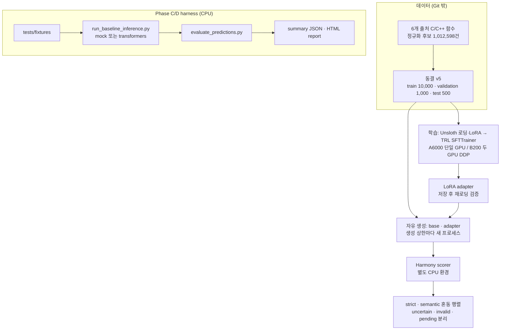

<div align="center">

# AegisLM

**GPT-OSS-20B를 C/C++ 함수의 취약 여부 판단 JSON 출력에 맞춰 LoRA/QLoRA로 파인튜닝하고, 재현 가능한 평가 harness로 검증하는 보안 분석 특화 LLM 연구 저장소**

[](pyproject.toml)
[](uv.lock)
[](docs/FINETUNING_EXPERIMENT_PLAN.md)
[](docs/FINETUNING_EXPERIMENT_PLAN.md)
[](pyproject.toml)
[](configs/environments/README.md)
[](https://github.com/Malicious-code-detection-project/AegisLM/commits/main)

[빠른 시작](#빠른-시작) · [튜토리얼](#튜토리얼) · [구조](#현재-구조) · [결과](#결과) · [로드맵](#개발-로드맵) · [A6000 실험표](docs/A6000_EXPERIMENT_TABLES.md) · [B200 실험표](docs/B200_EXPERIMENT_TABLES.md) · [B200 재현 레시피](docs/B200_REPRODUCTION_RECIPE.md)

</div>

`AegisLM`은 Project NuriLab과 연계할 수 있는 별도 LLM 모델 개발 프로젝트입니다.

이 저장소는 보안 분석 시스템 자체를 구현하기보다, 보안 분석에 특화된 로컬 LLM을 학습, 평가, 개선하는 데 집중합니다.
Project NuriLab이 분석 파이프라인과 운영 시스템을 담당한다면, AegisLM은 그 시스템에 연결될 수 있는 모델, 어댑터,
데이터셋, 평가 방법을 준비합니다.

현재 단계는 **Phase E: SFT 학습·adapter 재현과 평가 검증**입니다. 2026-10-07 기준으로 B200 두 GPU DDP의 100-step 학습과
adapter 저장 검증은 끝났지만, 같은 validation100에 대한 base·adapter 생성 평가는 **준비만 완료됐고 0/1,200회 실행**입니다.
학습 완료를 탐지 성능 개선으로 읽지 않습니다.

## 하이라이트

- **모델은 최종 보안 판단자가 아닙니다.** 판단 근거는 deterministic analyzer, rule signal, curated evidence에 두고, 모델은 설명·요약·매핑·보고서 구조화를 담당합니다.
- **동결한 C/C++ 데이터 v5.** 6개 출처에서 정규화한 후보 1,012,598건 중 원천 라벨이 있는 10,000/1,000/500건을 분리했고, 최종 파일 기준 분할 간 중복 검사를 통과했습니다. 원천 라벨 기반 후보이며 CWE 판단과 근거 줄 검수는 아직 하지 않았습니다.
- **실험 환경을 lock으로 보존합니다.** A6000·B200 결과를 낸 환경은 루트 lock과 별개인 `configs/environments/`의 독립 uv 프로젝트(native 113개, Harmony scorer 11개 패키지)로 고정했습니다.
- **실패도 결과로 남깁니다.** canary 0/40 실패, OOM으로 멈춘 평가, 벤치마크 중복으로 막힌 준비 단계를 지우지 않고 기록합니다. 학습 stage와 gate evidence는 append-only로 다룹니다.
- **CPU만으로 harness를 확인할 수 있습니다.** mock 추론 → 평가, 학습 config dry-run, 단위 테스트는 GPU·모델 가중치 없이 돕니다.
- **모델·adapter·데이터는 Git 밖에 둡니다.** `data/`, `adapters/`, `checkpoints/`, `models/`, `outputs/`는 Git 제외 경로입니다.

## 빠른 시작

요구 환경은 Python 3.12 이상과 [uv](https://docs.astral.sh/uv/)입니다. 아래 단계에는 GPU가 필요하지 않습니다.

```bash
git clone https://github.com/Malicious-code-detection-project/AegisLM.git
cd AegisLM
uv sync
uv run python main.py
```

`uv sync`는 기본 의존성(`jsonschema`, `python-dotenv`, `wandb`)과 `dev` 그룹(`pytest`, `ruff`, `mypy`)만 설치합니다.
torch·Unsloth·TRL이 들어 있는 `training` 그룹과 `data-prep` 그룹은 설치하지 않습니다.

`main.py`는 기본 실행에서 모델이나 로컬 데이터를 불러오지 않고 상태 문구만 출력합니다.

```text
AegisLM scaffold is ready. See README.md and docs/FINETUNING_EXPERIMENT_PLAN.md for the roadmap.
```

GPU 학습·생성 환경은 루트 lock이 아니라 [B200 가상환경](#b200-가상환경)과 [B200 재현 레시피](docs/B200_REPRODUCTION_RECIPE.md)를 따릅니다.

## 튜토리얼

아래 단계는 모두 CPU에서 돌고, 모델 가중치·비공개 데이터·GPU를 쓰지 않습니다.
출력은 2026-11-18 WSL2(Ubuntu, Python 3.12, uv 0.11.13)의 새 clone(main `269bd24`)에서 실제로 실행한 결과입니다.

### 1. mock 추론 → 평가 harness

Phase C의 tiny fixture(`tests/fixtures/tiny_phase_c_records.jsonl`, 5건)에 고정 응답을 내는 mock backend로 prediction JSONL을 만들고,
같은 fixture 기준으로 채점합니다. 실제 모델 benchmark가 아니라, harness가 불완전한 출력을 어떻게 기록하는지 보는 재현 가능한 실패 기준선입니다.
절차는 [평가 계획](docs/EVALUATION_PLAN.md) 9절과 같습니다.

```bash
uv run python scripts/run_baseline_inference.py \
  --dataset tests/fixtures/tiny_phase_c_records.jsonl \
  --predictions outputs/tutorial/baseline_predictions.jsonl \
  --model-id mock-baseline-smoke \
  --run-id tutorial-smoke \
  --backend mock \
  --mock-raw-output '{"summary":"mock raw output"}'

uv run python scripts/evaluate_predictions.py \
  --dataset tests/fixtures/tiny_phase_c_records.jsonl \
  --predictions outputs/tutorial/baseline_predictions.jsonl \
  --summary-json outputs/tutorial/evaluation_summary.json \
  --report-html outputs/tutorial/evaluation_report.html
```

```text
AegisLM baseline inference complete: records=5, predictions=outputs/tutorial/baseline_predictions.jsonl
AegisLM evaluation complete: score=39.43, hard_gate=0.0%
```

`outputs/tutorial/`에 `baseline_predictions.jsonl`, `evaluation_summary.json`, `evaluation_report.html`이 생깁니다.
mock 출력은 JSON 파싱에는 성공하지만 필수 필드가 부족해 **schema·hard gate는 FAIL**입니다. 의도한 결과입니다.
`evaluation_summary.json`의 `metrics` 중 주요 값은 다음과 같습니다.

| 지표 | 값 |
| --- | ---: |
| `total_count` | 5 |
| `json_parse_success_rate` | 1.0 |
| `schema_validation_pass_rate` | 0.0 |
| `hard_gate_pass_rate` | 0.0 |
| `required_field_completeness` | 0.1429 |
| `safety_pass_rate` | 1.0 |
| `composite_score` | 39.4286 |

prediction 출력 경로가 이미 있으면 덮어쓰지 않고 멈춥니다. 같은 명령을 다시 실행하면 다음 오류로 끝나므로,
다시 실행할 때는 `outputs/tutorial-2/`처럼 새 경로를 씁니다. `outputs/`는 Git 제외 경로입니다.

```text
FileExistsError: artifact output already exists: outputs/tutorial/baseline_predictions.jsonl
```

### 2. 학습 config dry-run

학습을 시작하지 않고 config 파싱, 출력 경로의 Git 제외 정책과 쓰기 권한을 점검합니다.

```bash
uv run python scripts/dry_run_training.py --config configs/tiny_sft_config.json
```

```text
============================================================
Starting Training Config Dry-run for: configs/tiny_sft_config.json
============================================================
[SUCCESS] 1. Config parsed and schema verified.
[SUCCESS] 2. Directory writability/creation verified.
         [WARNING] Dataset files do not exist yet. Path check passed, but actual SFT training will require these files.
[INFO] 3. Skipping dataset format validation (Dataset files not created yet).
[INFO] 4. Model/Tokenizer load check skipped (use --check-model to enable).
============================================================
Dry-run completed successfully! Configuration is valid.
============================================================
```

`data/tiny_sft_train.jsonl`이 clone에 없으므로 데이터셋 형식 검사는 건너뜁니다. tokenizer 확인은 `--check-model`을 줄 때만 하며,
이때는 `transformers`와 모델 다운로드가 필요합니다.
이 명령은 config에 적힌 `adapters/tiny-sft-poc`, `checkpoints/tiny-sft-poc`, `models/cache` 빈 디렉터리를 만듭니다. 모두 Git 제외 경로입니다.

### 3. 테스트

기본 `uv sync`만 한 환경에서 `uv run pytest tests/`를 실행하면, `torch`·`numpy`를 import하는 3개 파일
(`tests/test_diagnose_source_canary.py`, `tests/test_source_gate.py`, `tests/test_source_peft_control.py`)의
수집 단계에서 `ModuleNotFoundError`가 나고 `3 errors during collection`으로 멈춥니다.
가벼운 환경에서는 이 3개 파일을 제외합니다.

```bash
uv run pytest tests/ \
  --ignore=tests/test_diagnose_source_canary.py \
  --ignore=tests/test_source_gate.py \
  --ignore=tests/test_source_peft_control.py
```

```text
569 passed, 1 skipped in 13.16s
```

전체 테스트는 `training` 그룹(torch 2.10.0, CUDA 12.8 런타임 휠 포함)을 함께 설치한 뒤 실행합니다. 이 테스트들도 CPU에서 돕니다.

```bash
uv sync --group training
uv run pytest tests/
```

```text
615 passed in 22.42s
```

## 현재 구조



| 영역 | 책임 |
| --- | --- |
| `aegislm/schemas.py` | JSON output contract, dataset record shape |
| `aegislm/prompts/` | system/user prompt template |
| `aegislm/datasets/` | dataset formatting, validation, C/C++ source corpus |
| `aegislm/evaluation/` | JSON validity, required fields, safety checks, source decision 채점 |
| `aegislm/inference/` | base model과 adapter inference helper |
| `aegislm/training/` | TRL / Unsloth training helper, config, gate |
| `aegislm/tracking/` | 선택적 W&B 기록과 실행 receipt |
| `scripts/` | 데이터·추론·학습·평가 진입점, `scripts/b200/`의 DDP launcher |
| `configs/` | 실험 config와 독립 실험 환경(`configs/environments/`) |

W&B 기록은 `--wandb`를 명시한 실행에서만 켜집니다. 자격 증명과 상세 실행법은 [파인튜닝 실험 계획](docs/FINETUNING_EXPERIMENT_PLAN.md)을 따릅니다.

## 결과

아래 수치는 [A6000 실험표](docs/A6000_EXPERIMENT_TABLES.md), [B200 실험표](docs/B200_EXPERIMENT_TABLES.md),
[데이터 전략](docs/DATA_STRATEGY.md), [파인튜닝 실험 계획](docs/FINETUNING_EXPERIMENT_PLAN.md)에서 옮겼습니다.
학습 loss는 탐지 성능이 아니며, A6000과 B200의 loss·시간 차이를 GPU만의 효과로 해석하지 않습니다.

### 데이터 v5 (2026-09-28 재구성)

`data/processed/cc-source-candidates-20260928-v5`(Git 밖). 정규화 풀은 6개 출처(PrimeVul, DiverseVul, BigVul, Juliet, CVEfixes, DecompileBench)의
1,012,598건입니다. CVEfixes와 DecompileBench는 범위가 정해진 라벨이 없어 분할에 넣지 않았습니다.

| 출처 | Train | Validation | Test |
| --- | ---: | ---: | ---: |
| PrimeVul | 3,315 | 368 | 198 |
| DiverseVul | 3,259 | 367 | 174 |
| BigVul | 3,281 | 260 | 128 |
| Juliet | 145 | 5 | 0 |
| 합계 | 10,000 | 1,000 | 500 |

- 각 분할은 양성/음성 원천 라벨 수가 같습니다. 같은 코드에 상반된 라벨이 붙은 3,009개 hash는 선택에서 뺐습니다.
- 최종 파일 기준 코드·CVE·커밋·함수 그룹과 설정된 유사도 기준의 분할 간 중복은 0입니다. 이 검사는 builder가 다시 계산한 것이며 독립 검토자의 승인은 아닙니다.
- **라벨은 미검수입니다.** 원천 라벨 기반 후보이며 CWE 판단과 근거 줄 검수는 완료하지 않았습니다.

### A6000 — 단일 GPU native 30/100-step

RTX A6000 1장, `cc-native-step100` 환경(torch 2.14.1+cu130), `unsloth/gpt-oss-20b-unsloth-bnb-4bit`, LoRA r8.

| 지표 | 30-step | 100-step |
| --- | ---: | ---: |
| 평균 train loss | 0.230625 | 0.130558 |
| 마지막 step loss | 0.0996 | 0.0860 |
| Trainer train runtime (초) | 226.963 | 656.811 |
| source / effective records | 10,000 / 8,525 | 10,000 / 8,525 |
| 학습·adapter 저장 | 완료 | 완료 |

생성 평가는 끝나지 않았습니다.

- validation 2건 × 5개 생성 상한(총 20호출) 진단은 완료했지만, 표본 2건이므로 품질 합격 근거가 아닙니다.
- validation100 자유 생성 v2는 adapter 128/512/2048 상한 각 100건과 65536 상한 2건, 합계 **302/1,200회에서 CUDA OOM으로 멈췄습니다.** base 6조건은 이 run에서 시도하지 않았습니다.

| adapter 상한 | 완료/계획 | TP | FN | FP | TN | invalid | pending |
| --- | ---: | ---: | ---: | ---: | ---: | ---: | ---: |
| 128 | 100/100 | 0 | 1 | 0 | 0 | 99 | 0 |
| 512 | 100/100 | 4 | 10 | 2 | 18 | 66 | 0 |
| 2048 | 100/100 | 19 | 21 | 11 | 33 | 16 | 0 |
| 65536 | 2/100 | 2 | 0 | 0 | 0 | 0 | 98 |

### B200 — 두 GPU DDP 100-step

NVIDIA B200 2장, torchrun 한 노드·두 rank, `cc-native-step100` 환경(torch 2.14.1+cu130), 전체 batch 4로 A6000과 맞췄습니다.

| run | optimizer step | 결과 |
| --- | ---: | --- |
| `b200-ddp2-step100-v1` | 0 | 런처 단계 실패 |
| `b200-ddp2-step100-v2` | 1 | DDP reduction 실패 (sparse MoE unused parameter) |
| `b200-ddp2-step100-v3` | 100 | **학습·저장·검증 완료** |

| 지표 (v3, 두 rank 동일) | 값 |
| --- | ---: |
| 평균 train loss | 0.1298 |
| 마지막 step loss | 0.0814 |
| Trainer train runtime (초, rank0 / rank1) | 277.8209 / 275.9026 |
| 변경 tensor / 전체 trainable tensor | 3,176 / 3,264 |
| 최종 LoRA hash | 두 rank 완전 일치 |

**base·adapter 자유 생성 평가: 준비 완료, 0/1,200회 미실행.** 같은 validation100(양성 50·음성 50)에 모델마다 6개 생성 상한,
각 모델 600회를 계획했고 입력·scorer 준비만 끝났습니다. raw 결과 파일은 두 arm 모두 0개이며, 이를 성능 0%로 읽지 않습니다.
생성·Harmony 채점을 한 명령(`scripts/b200/run-evaluation.sh plan|start|status|stop`)으로 실행하고 진행·실패 상태를 모으는 방법은
[B200 자동 평가 실행 안내](docs/B200_REPRODUCTION_RECIPE.md#16-자유-생성-평가를-한-명령으로-실행)에 있습니다.
이 진입점 추가는 GPU 평가 완료나 품질 개선을 뜻하지 않습니다.

### 이전 부정 결과

| 날짜 | 실험 | 결과 |
| --- | --- | --- |
| 2026-09-10 | source-v2 1,000-record Unsloth QLoRA canary | 학습·저장·재로딩 성공, held-out JSON/schema/grounding gate **0/40 FAIL** (31/40 JSON 파싱 실패) |
| 2026-09-11 | 복구 canary 2종 (`unsloth_v2`, 직접 PEFT control) | 둘 다 **0/40 FAIL**. JSON parse 16/40·5/40, EOS 24/40·9/40 |
| 2026-09-28 | `source_two_stage_v1` 준비 검증 | 토큰 검사는 통과했으나 B200 `fresh-blind-500` 중 **498/500이 train/validation과 같은 코드**를 포함해 준비 단계에서 차단. GPU 학습은 시작하지 않음 |
| 2026-10-03 | v5 base development100 | 128-token 예산에서 100건 모두 final JSON 생성 실패 |

canary 실패로 full 10,000-record 학습과 base/adapter 본 비교는 그 시점에 실행하지 않았습니다.
2026-09-27에 사용자가 비교 목적의 탐색적 본 학습을 따로 승인했으며, canary 실패 기록은 그대로 둡니다.

<details>
<summary>2026-09-28 ~ 2026-10-07 연구 기록 (이전 README 첫머리)</summary>

2026-10-07 최신 기록은 [A6000 실험표](docs/A6000_EXPERIMENT_TABLES.md)와
[B200 실험표](docs/B200_EXPERIMENT_TABLES.md)로 환경별로 구분합니다.
B200 두 GPU DDP의 100-step 학습·adapter 저장 검증을 완료했고,
동일 validation100의 base·adapter 생성 평가는 준비 완료·0/1,200회입니다.
생성·Harmony 채점을 한 명령으로 실행하고 진행·실패 상태를 모으는 방법은
[B200 자동 평가 실행 안내](docs/B200_REPRODUCTION_RECIPE.md#16-자유-생성-평가를-한-명령으로-실행)를 참고합니다.
A6000의 완료된 2건 진단, 100건 평가 OOM, 후속 base 착수 기록을 구분하며
환경 차이가 있는 학습 loss·시간을 탐지 성능 개선이나 GPU만의 효과로 해석하지 않습니다.

2026-09-28 C/C++ 원천 데이터 재구성 결과는
`data/processed/cc-source-candidates-20260928-v5`에 보관합니다. 여섯 원천의
1,012,598개 후보를 공통 형식으로 정리하고, 그중 판단 라벨이 있는
10,000/1,000/500건을 분리했습니다. 최종 파일 기준 코드·CVE·커밋·함수
그룹 및 설정된 유사도 기준의 분할 간 중복 검사를 통과했습니다.
이는 원천 라벨 기반 후보이며, CWE 판단과 근거 줄 검수는 아직 완료되지
않았습니다. 세부 계약과 재현 방법은 [데이터 전략](docs/DATA_STRATEGY.md)의
C/C++ raw-source reconstruction 절을 참고합니다.
2026-09-29 결정에 따라 이력을 보존했고, 2026-10-02 재생성 검증 후
중간 v1–v4 정리를 완료했습니다. 정규화 풀은 별도 캐시로 이관했으며
최종 v5의 파일과 10,000/1,000/500 구성은 그대로 유지됩니다.

2026-10-03 RTX A6000 1장에서 v5 판단 전용 base development100 평가와
Unsloth 100-step 본 학습을 완료했습니다. 평균 학습 loss는 0.209771,
마지막 step loss는 0.028211이며 W&B에서 100개 step 기록과 종료 상태를
확인했습니다. 최종 adapter는 새 프로세스에서 저장값과 일치했습니다.
2026-10-03 해당 실행 경로는 `cc-decision-20261002-v7`입니다. base는 128-token 예산에서
100건 모두 final JSON을 생성하지 못했습니다. test500 품질 비교는 아직
실행하지 않았으며, 이전 batch2 수치 비교 실패도 진단 이력으로 남아 있습니다.

2026-10-03에는 `max-new-tokens-65536` 생성 한도 비교 실험도 완료했습니다.
동일 validation 2건에서 base는 2,048/65,536 한도로 JSON 1건이 회복됐지만
adapter는 모든 한도에서 JSON 0건이었고 message/channel token 반복이 나타났습니다.
전체 문맥 한도 131,072와 생성 상한 65,536을 구분해 기록했으며, 실험표·가설·
중간 실패·재현 자료는 [실험 계획의 `max-new-tokens-65536` 절](docs/FINETUNING_EXPERIMENT_PLAN.md)에 보존합니다.

2026-10-04에는 공식 Unsloth GPT-OSS-20B 예제를 기준으로 재시작하기로 했습니다.
공식 노트북·Python 예제·출처와 hash를 확보하고 기존 경로와 차이를 기록했습니다.
세부 내용은 [공식 예제 확보 기록](docs/FINETUNING_EXPERIMENT_PLAN.md#2026-10-04-unsloth-official-gpt-oss-20b-reference)을 참고합니다.
기존 학습 코드와의 CPU 비교에서는 32건의 입력 마스킹·EOS는 정상이었고,
공식 final-only mask와 달리 빈 analysis 및 final header 9토큰도 학습했습니다.
이 차이의 인과는 미확정이며, [코드 비교 기록](docs/FINETUNING_EXPERIMENT_PLAN.md#2026-10-04-final-only-mask-vs-empty-analysis-code-review)에 확인된 평가 설정 문제와 함께 남겼습니다.

공식 예제의 SFTTrainer/final-only 경로와 native EOS 비교를 위한 새 recipe는
[실험 실행 기록](docs/FINETUNING_EXPERIMENT_PLAN.md#2026-10-04-sfttrainer-final-only-mask-eos-return)에 기록합니다.
GPU 사전 검사 통과 후 100-step 학습과 최종 어댑터 저장을 완료했습니다.
평균 학습 loss는 0.119957, 최종 검증 loss는 4.981067로 차이가 큽니다.
저장한 어댑터를 새 프로세스에서 불러온 동일 validation 2건 비교에서
bare-assistant는 둘 다 analysis 반복 후 시간 제한에 도달했습니다.
gold-free final-prefill은 둘 다 JSON/schema 및 원천 라벨이 일치했고,
7/9토큰 뒤 native return으로 종료했습니다. 기존 8행에 새 2행을 추가했습니다.
이는 시작 형식의 영향에 대한 진단이며, 표본 2건으로 품질 합격을 주장하지 않습니다.

같은 날 [context-window-max-131072 실험](docs/FINETUNING_EXPERIMENT_PLAN.md#2026-10-04-context-window-max-131072-generation-experiment)도 완료했습니다.
입력을 뺀 최대 생성 상한 130,770–130,837을 적용했지만 adapter/bare는
같은 출력 접두부를 반복하다 300초 제한에 걸렸고, final-prefill은 이전과 같은
7/9토큰으로 종료했습니다. 실제 최대 길이까지 생성한 실험은 아닙니다.

이후에는 [원본 튜토리얼 학습·최대 생성 상한 실험](docs/FINETUNING_EXPERIMENT_PLAN.md#2026-10-04-unsloth-original-max-new-tokens-131072-training)을 분리했습니다.
원본 Multilingual-Thinking 데이터와 1,024-token/30-step 설정으로 새 학습을
완료했고, 평균 loss는 1.024378입니다. 로컬 compiler 호환 오류의 실패 이력을
보존하고 Unsloth의 compiler-off 경로를 사용했습니다. 동일 runtime의
base/adapter 8조건 비교도 완료했습니다. 최대 생성 예산 130,950의 4조건은
모두 600초 제한에 도달했고 adapter medium만 부분 final이 있었으며,
native EOS는 0/4입니다. 실제 생성량은 약 3,000으로 최대 길이를 소진한 검증은
아닙니다. 이 수학 시연을 C/C++ 판단 품질 비교와 구분해 기록합니다.
이전 실험의 600초 제한은 사용자가 승인하지 않은 조건 변경이었으므로,
생성 상한만 바꾼 공식 재현 결과로 간주하지 않습니다.

[공식 튜토리얼 그대로의 새 실행](docs/FINETUNING_EXPERIMENT_PLAN.md#2026-10-04-unsloth-official-tutorial-generation-64)은
새 독립 환경에서 학습 1,024토큰·30스텝, 원본 생성 5회·64토큰을 완료했습니다.
compiler 우회와 외부 시간 제한 없이 평균 train loss 1.003214를 기록하고
adapter를 저장했습니다. 생성 5회 모두 64토큰 예산을 소진해 analysis 중간에서
끝났으며 완성된 final은 없습니다. 실제 원본 mask는 final만 직접 학습하고
analysis는 제외하므로, 이 결과를 French reasoning 적응 성공으로 보지 않습니다.
validation과 W&B는 원본대로 비활성입니다. 결과표·원문·라벨 검사를 보고서에 기록했습니다.

이어서 [공식 학습에 v5 데이터를 연결하는 실험](docs/FINETUNING_EXPERIMENT_PLAN.md#2026-10-04-official-tutorial-v5-dataset-token-caps)을 완료했습니다.
원본 1,024토큰·30스텝의 평균 train loss는 0.230625입니다. 실제 유효 train은
8,525건이며, 동일 validation 2건에 공식 기본 생성과 5개 토큰 상한을 적용한
base/adapter 20호출을 마쳤습니다. adapter는 2,048/65,536/남은 최대 문맥 조건에서
두 건 모두 유효 JSON과 원천 라벨 일치를 기록했습니다. 짧은 예산의 실패와
정상 Harmony final을 누락한 평가 파서 3건을 구분해 결과표에 남겼습니다.
이는 2건 진단이며 전체 test500 품질 검증은 아닙니다.

같은 데이터·독립 환경·생성 조건에서 [max_steps만 100으로 늘리는 실험](docs/FINETUNING_EXPERIMENT_PLAN.md#2026-10-04-official-tutorial-v5-max-steps-100)도 완료했습니다.
평균 train loss는 0.130558로 낮아졌지만 생성 20호출에서 일관된 품질 개선은
확인되지 않았습니다. adapter 512는 라벨 일치 2/2, 2048은 0/2, 65536·최대 문맥은
각 1/2였으며 오분류·tool request·추가 필드 실패를 구분했습니다.
같은 초기 가중치·학습 설정·데이터·생성 코드를 대조했고 30step 비교표를 보존했습니다.

2026-10-05 [vLLM 서빙과 판단 학습의 차이·오류 분석](docs/GPT_OSS_SERVING_TRAINING_ERROR_ANALYSIS.md)을 작성했습니다.
최근 100step 학습은 완료됐으며, 생성 예산 소진·tool handoff·출력 계약·판단 오류와
평가 파서의 누락을 구분했습니다. 현재 학습 target은 판단 한 필드이고 이유·추천
사항의 학습·품질 평가와는 다릅니다. 과거 vLLM 성공 사례와의 동일 조건 비교는 미검증입니다.

2026-10-06 코드 감사에서 생성 상한을 바꿀 때 모델을 다시 로드하지 않았음을 확인했습니다.
모델×상한마다 새 프로세스로 평가하도록 수정하고 입력 준비·CPU 검증을 마쳤습니다.
이후 v2 GPU 평가에서 조건별 프로세스 종료·재로딩을 실측했습니다.
adapter의 128/512/2048조건 각 100건과 65536조건 2건을 완료한 뒤,
같은 825token 입력에서 CUDA OOM으로 중단됐습니다. 새 302건은 기존 v1과
별도로 보존했으며, base와 나머지 상한은 미실행입니다. 초기화 요구는 실행된
4조건에서 확인했지만 메모리 부족은 해결되지 않았습니다.
[조건별 초기화 감사](docs/GPT_OSS_SERVING_TRAINING_ERROR_ANALYSIS.md#1113-2026-10-06-생성-상한-변경-시-모델-재로딩-여부-감사와-수정)에 근거와 제한을 기록합니다.
해당 v5 실행의 명령과 결과는
[v5 판단 학습 실행 안내](docs/FINETUNING_EXPERIMENT_PLAN.md#2026-10-02-v5-decision-only-execution)에 기록합니다.
기존 83개 데이터셋 폴더의 목적·결과·계보와 보존 조건은
[폴더 이력 및 정리 기록](docs/DATASET_ARTIFACT_INVENTORY.md)에 정리했습니다.

</details>

<details>
<summary>2026-09-28 GPT-OSS 2단계(Q1R10 decision + Q1R11 evidence) 재현 경로와 차단 기록</summary>

2026-09-28에는 B200의 성공 기준인 Q1R10 decision + Q1R11 evidence를
GPT-OSS에서 재현하는 `source_two_stage_v1` 경로를 추가했습니다. 동결된
판단·근거 데이터와 동일 평가 계약을 사용하며, 각각 base에서 100-step을
학습합니다. 준비/GPU 검증 → base dev100 → decision → evidence → 최종 평가를
순서대로 실행하고, 실패 시 다음 단계로 진행하지 않습니다. W&B 기록 확인을
학습 시작 조건으로 사용합니다. 실행 방법과 비교 조건은
`docs/FINETUNING_EXPERIMENT_PLAN.md`의 2026-09-28 항목을 따릅니다.
학습 완료와 품질 통과는 별도 실행 결과로 확인해야 합니다.

이 경로의 실제 준비 검증에서는 학습·검증 21,971건의 토큰 검사를
통과했지만, B200의 `fresh-blind-500` 중 498건이 현재 train/validation과
동일한 코드를 포함함을 확인했습니다. 준비 단계에서 차단했으며 GPU 학습과
W&B 학습 run은 시작하지 않았습니다. 원본은 보존하고, 실제 학습·검증 코드와
겹치지 않는 평가 세트를 먼저 확보해야 합니다. 상세 근거는 학습 계획 문서의
[`Actual preparation result: blocked by benchmark overlap`](docs/FINETUNING_EXPERIMENT_PLAN.md#actual-preparation-result-blocked-by-benchmark-overlap) 항목에 기록했습니다.

</details>

## 현재 초점

현재 저장소 단계는 **Phase E: SFT 학습·adapter 재현과 평가 검증**입니다.

현재 공식 native 기준선은 동결된
`data/processed/cc-source-candidates-20260928-v5`와 GPT-OSS-20B를 사용합니다.
A6000의 30/100-step 이력과 B200 두 GPU의 100-step 결과는 환경별로 기록하며,
B200 생성 평가는 입력·scorer 준비 완료 상태입니다. 학습·저장 완료와 평가 품질 통과를 구분합니다.

초기 기준 모델은 `openai/gpt-oss-20b`입니다.

v0 단계에서는 악성코드 유사 스크립트 동작 설명, 취약점 맥락 요약, CTI 메타데이터 정리, ATT&CK 매핑, 위험도 우선순위화를 JSON 형식으로 생성하는 모델을 목표로 합니다.

모델은 최종 보안 판단자가 아닙니다. 판단 근거는 deterministic analyzer, rule signal, curated evidence에 두고, 모델은 설명, 요약, 매핑, 보고서 구조화를 담당합니다.

<details>
<summary>초기 source-v2 canary 기록 (2026-09-10 ~ 2026-09-27, 당시 이력으로 보존)</summary>

2026-09-10 기준 1,000-record Unsloth QLoRA canary는 학습, expert adapter
저장, 재로딩까지 성공했지만 held-out JSON/schema/grounding gate가 0/40으로
실패했습니다. 따라서 full 10,000-record 학습과 base/adapter 본 비교는 아직
실행하지 않았으며, 실패 산출물은 Git 제외 경로에 보존합니다.

보존 산출물 재분석 결과 31/40은 JSON 파싱 실패였고, parse된 9건도 모두
contract를 위반했습니다. batch 1/8 재현에서는 동일한 8건의 JSON parse가
2/8 대 0/8로 달라져 batched generation 상호작용이 확인됐으며, checkpoint
25/100/final의 parse가 8/8, 6/8, 2/8로 악화돼 과적합 또는 control-token
degeneration도 별도 원인으로 확인했습니다. 수정 경로는 명시적인 low
reasoning/EOS/padding, batch-1 gate, 25-step checkpoint와 직접 PEFT injection
control을 사용합니다.

2026-09-11 복구 카나리도 같은 40건 gate에서 모두 0/40으로 실패했습니다.
`unsloth_v2`는 JSON parse 16/40·EOS 24/40, 직접 PEFT control은 parse
5/40·EOS 9/40이었고 두 adapter 모두 576개 LoRA tensor를 정상 저장·재로딩한
상태였습니다. 각 checkpoint-25의 고정 8건도 strict valid 0/8이어서 full
학습은 계속 차단합니다. 다음 데이터 분포 ablation을 위한 CWE/assessment
이중 층화 selector와 독립 config는 준비했지만, 현재 진단은 CWE 불균형보다
Harmony 제어 토큰 반복과 조기 semantic contract 실패를 우선 원인으로
지목하므로 해당 장시간 학습은 아직 실행하지 않았습니다.

학습 stage와 gate evidence는 append-only로 취급합니다. 완료되었거나 일부
산출물이 남은 stage를 같은 명령으로 다시 실행해 덮어쓰지 않으며, resume은
동일 config의 미완료 reservation과 그 checkpoint 바로 아래에서만 허용합니다.
full stage 승격 시에는 보고서의 집계값만 신뢰하지 않고 보존 prediction을
다시 채점해 record 집합, adapter 전체 artifact digest와 함께 검증합니다.

학습·평가·비교 결과는 선택적으로 Weights & Biases에 기록할 수 있습니다.
연동은 `--wandb`를 명시한 실행에만 활성화됩니다. 보존된 실패 canary의
source-free 집계와 125-step curve는 2026-09-11 W&B에 historical-import로
기록됐고, 복구 카나리 2종은 각각 별도 W&B run에 실패 결과로
보존됐습니다(run ID는 학습 계획 문서의 복구 카나리 표에 있습니다). 자격 증명과 상세 실행법은
`docs/FINETUNING_EXPERIMENT_PLAN.md`를 따릅니다.

2026-09-27에는 사용자가 AegisLM-B200의 Qwen3 실험과 비교할 목적으로
10,000/1,000/500 데이터 구성을 유지한 탐색적 본 학습을 승인했습니다.
기존 canary 실패는 유지하며, 별도 설정과 명시적 실행 사유를 통해 본 학습을
시작했습니다. 학습 완료나 품질 개선은 아직 확인하지 않았습니다. 실행 조건과
검증 범위는 `docs/FINETUNING_EXPERIMENT_PLAN.md`의 전체 데이터 비교 실험
기록을 따릅니다.

사용자가 직접 실행할 새 Unsloth recipe `unsloth_fresh_v1`과
`smoke → canary → full` 진입점을 추가했습니다. 이 recipe의 학습·GPU 검증은
진단 로그 추가 전 스모크 학습·adapter 재로딩은 완료했으나 출력 품질 gate는 통과하지 못했습니다.
입력·출력 진단 로그를 추가한 현재 변경은 정적 검사까지만 수행했습니다.
실행 명령과 제한사항은
[`새 Unsloth 수동 실행 안내`](docs/FINETUNING_EXPERIMENT_PLAN.md#15-fresh-unsloth-manual-run)를 참고합니다.

</details>

## 핵심 목표

- 로컬 LLM 파인튜닝 실험
- LoRA / QLoRA 기반 학습 경로 검증
- 보안 분석 특화 데이터셋 구성과 정제
- JSON 구조화 출력 학습
- 모델 출력 품질 평가 harness 준비
- 장기적으로 보안 분석 특화 LLM 모델 직접 구축

## 개발 로드맵

**Phase A: 문서/저장소 정체성 정리 (완료)**

이 프로젝트는 Project Nurilab : 로컬 LLM 기반 악성코드 분석 자동화 시스템 개발 프로젝트에서 `로컬 LLM 파인 튜닝 또는 LLM 모델링` 부분을 담당하는 프로젝트입니다. `README.md`, `AGENTS.md`, `docs/CONTRIBUTING.md`의 방향성은 이 기준에 맞춰 정리했습니다.

**Phase B: 최소 코드 뼈대 생성 (완료, 최초 push 준비)**

학습 코드를 바로 크게 만들기보다, 데이터, 평가, 학습, 추론의 책임 경계를 나누는 얇은 scaffold를 만듭니다. 이 단계의 목표는 전체 구조를 이해할 수 있는 최소 패키지와 디렉터리 구조를 만드는 것입니다. 실제 학습 방식, notebook/script/config 중심 선택, TRL/Unsloth 우선순위는 Phase B 이후에 결정합니다.

**Phase C: 데이터 전략 + JSON schema + tiny dataset (완료)**

데이터 활용 전략을 먼저 정리한 뒤 모델이 생성해야 할 JSON output contract를 코드와 문서 양쪽에서 고정하고, 5-20개 수준의 작은 synthetic 또는 metadata-only 학습 예시를 준비합니다. 이 단계에서는 대형 데이터셋, 실제 악성 샘플, GPU 학습, RAG embedding index 생성을 다루지 않습니다.

**Phase D: baseline inference + evaluation (완료)**

파인튜닝 전에 `openai/gpt-oss-20b` 기본 모델의 출력과 평가 기준선을 확인하는 구조를 마련했습니다. baseline inference, JSON parse success, required field completeness, hallucinated ATT&CK mapping, unsafe guidance 여부를 adapter 개선 전 비교 기준으로 사용합니다.

-> **Phase E: tiny SFT PoC (진행 중)**

작은 데이터셋으로 Unsloth QLoRA와 Hugging Face TRL LoRA / QLoRA 경로를 비교합니다. 목표는 큰 성능 향상이 아니라, 학습 루프, adapter 저장/로드, held-out evaluation 비교 흐름을 끝까지 검증하는 것입니다.

**Phase F: dataset 확장 + adapter 개선**

평가 기준이 안정된 뒤 NVD, CISA KEV, MITRE ATT&CK, 공개 CTI, Project NuriLab synthetic fixture 같은 안전한 데이터 소스를 확장합니다. adapter 품질은 JSON 유효성, 설명 품질, ATT&CK 매핑 정확도, 안전성 기준으로 개선합니다.

**Phase G: 직접 모델/레이어 연구**

LoRA / QLoRA, dataset, evaluation이 충분히 안정된 뒤 직접 모델 구조 변경, custom layer, continued pretraining 같은 연구를 검토합니다. 이 단계는 장기 목표이며, v0에서는 architecture modification을 하지 않습니다.

## 왜 별도 프로젝트인가

LLM 모델 개발은 분석 파이프라인 구현과 다른 속도로 움직입니다. 학습 데이터, GPU 환경, 모델 체크포인트, 평가 기준, 안전 정책은 별도의 실험 관리가 필요합니다.

따라서 이 프로젝트는 Project NuriLab의 코드 구조나 릴리스 일정에 종속되지 않고, 모델 개발 관점에서 독립적으로 실험을 축적합니다.

## Project NuriLab과의 관계

이 프로젝트는 Project Nurilab : 로컬 LLM 기반 악성코드 분석 자동화 시스템 개발 프로젝트에서 `로컬 LLM 파인 튜닝 또는 LLM 모델링` 부분을 담당하는 프로젝트입니다.

Project NuriLab은 AegisLM의 자체 검증이 끝난 뒤 base model 식별자와
fine-tuned adapter, 평가 결과, JSON output contract를 전달받을 수 있습니다.
성능 결과가 향상·동등·저하 중 무엇이든 유효하게 로드되는 산출물과 결과를
보존합니다.

Project NuriLab 저장소 수정, 런타임 연결, 통합 검증은 Project NuriLab의
책임이며 현재 AegisLM 실험 범위에 포함하지 않습니다.

## 범위 밖

- 정적 분석 pipeline 구현
- Python analyzer rule 관리
- HTML 운영 보고서 생성기 구현
- 사용자 CLI 제품화
- Project NuriLab의 전체 배포 정책 정의
- Project NuriLab 연동 코드, 설정, CLI, 통합 테스트 구현
- 실제 악성 샘플 저장 또는 실행
- secrets, private CTI, private customer data 저장

## 폴더 구조

```text
AegisLM/
├── main.py                 # 상태 출력 진입점 (기본 실행은 ML 자원을 불러오지 않음)
├── aegislm/
│   ├── schemas.py          # JSON output contract, dataset record shape
│   ├── prompts/            # prompt template
│   ├── datasets/           # formatting, validation, C/C++ source corpus
│   ├── evaluation/         # harness, source decision·evidence 채점
│   ├── inference/          # base·adapter inference helper
│   ├── training/           # TRL / Unsloth helper, config, gate
│   └── tracking/           # 선택적 W&B 기록, 실행 receipt
├── scripts/                # 데이터·추론·학습·평가 진입점
│   └── b200/               # 두 GPU DDP 학습·평가 launcher
├── configs/                # 실험 config (tiny_sft_config.json 포함)
│   └── environments/       # 실험 결과를 낸 독립 uv 환경 (cc-native-step100, cc-harmony-score)
├── tests/                  # 단위 테스트와 fixtures/
├── docs/                   # 계획·데이터·평가·실험표·재현 레시피
├── experiments/            # PoC 실험 기록 (그 밖의 산출물은 Git 제외)
└── references/             # 선택형 개인 하네스 참고 자료
```

`data/`, `adapters/`, `checkpoints/`, `models/`, `outputs/`, `wandb/`는 `.gitignore`에 들어 있으며 커밋하지 않습니다.

## B200 가상환경

B200 Linux의 프로젝트 루트에서 필요한 환경 하나를 활성화한다.

학습·응답 생성용:

```bash
source configs/environments/cc-native-step100/.venv/bin/activate
```

CPU 채점용:

```bash
source configs/environments/cc-harmony-score/.venv/bin/activate
```

활성화 해제는 `deactivate`, Python 버전 확인은 `python --version`이다.
설치·환경 전환·실행 방식은 [독립 실험 환경 README](configs/environments/README.md#가상환경-활성화와-전환)를 따른다.

### 루트 lock과 실험 환경의 차이

A6000·B200 결과는 루트 lock이 아니라 독립 환경에서 나왔습니다. 루트에서 `uv sync --group training`을 실행해도 같은 실험이 되지 않습니다.

| 환경 | 정의 파일 | Python | torch / CUDA | 쓰임 |
| --- | --- | --- | --- | --- |
| 루트 | [`pyproject.toml`](pyproject.toml), [`uv.lock`](uv.lock) | `>=3.12` | `training` 그룹: torch 2.10.0, CUDA 12.8 휠 (transformers 5.5.0, Unsloth 2026.6.9) | CPU 도구·테스트·W&B tracker |
| `cc-native-step100` | [`configs/environments/cc-native-step100/`](configs/environments/cc-native-step100/pyproject.toml) | `>=3.12,<3.13` (A6000 3.12.13, B200 3.12.3) | torch 2.14.1+cu130 / CUDA 13.0 (transformers 4.56.2, Unsloth 2026.9.14) | A6000·B200 학습·응답 생성 |
| `cc-harmony-score` | [`configs/environments/cc-harmony-score/`](configs/environments/cc-harmony-score/pyproject.toml) | `>=3.12,<3.13` | 없음 (openai-harmony 0.0.8) | CPU 채점 |

## 개발

코드 변경 PR 전에는 가능한 범위에서 다음 검사를 실행합니다([품질 기준](docs/QUALITY_GATES.md)).

```bash
uv run pytest tests/
uv run ruff check .
uv run ruff format --check .
uv run mypy aegislm/ tests/
```

2026-10-08에는 루트 lock의 개발 도구에 기존 native 환경 라이브러리를 읽기 전용으로 참조한 별도 환경에서 GPU 없이
pytest 597개, Ruff lint·format, mypy를 통과했습니다([B200 실험표](docs/B200_EXPERIMENT_TABLES.md) 7절).
2026-11-18 새 clone(main `269bd24`)에서는 `uv sync --group training` 뒤 `uv run pytest tests/`가 615개 모두 통과했습니다.
실제 GPU, 대형 모델, 외부 dataset이 필요한 검증은 일반 PR 필수 테스트로 만들지 않고 experiment log에 기록합니다.

- 테스트는 pytest-style function/assert로 작성하고 `unittest.TestCase` 패턴은 새로 추가하지 않습니다.
- 브랜치는 `docs/`, `feat/`, `fix/`, `test/`, `refactor/`, `experiment/` 접두어를 쓰고, PR 제목은 `[AegisLM] <summary>` 형식입니다.
- schema, dataset format, prompt contract, evaluation metric, artifact storage policy를 바꾸면 문서와 테스트를 함께 갱신합니다.
- 실제 악성 샘플, secrets, raw dataset, checkpoint, adapter artifact는 커밋하지 않습니다.

[협업 규칙](AGENTS.md), [기여 절차](docs/CONTRIBUTING.md), [PR 템플릿](docs/PR_DESCRIPTION_TEMPLATE.md)을 참조하세요.

## 문서

선택형 개인 하네스는 [v4 진입점](references/이정민/index.md)에서 확인합니다.

- [`AGENTS.md`](AGENTS.md) - 협업 운영 규칙
- [`CONTRIBUTING.md`](CONTRIBUTING.md) - 기여 절차 안내
- [`docs/README.md`](docs/README.md) - 세부 문서 인덱스와 문서 관리 규칙
- [`docs/ARTIFACT_STORAGE_POLICY.md`](docs/ARTIFACT_STORAGE_POLICY.md) - fine-tuning 산출물 저장 정책
- [`docs/DATASET_CANDIDATES.md`](docs/DATASET_CANDIDATES.md) - 공개 데이터셋 후보 registry와 안전성/용도 분류
- [`docs/DATA_STRATEGY.md`](docs/DATA_STRATEGY.md) - Phase C 데이터 활용 전략
- [`docs/DATASET_ARTIFACT_INVENTORY.md`](docs/DATASET_ARTIFACT_INVENTORY.md) - 기존 데이터셋 폴더 이력과 정리 의존성
- [`docs/EVALUATION_PLAN.md`](docs/EVALUATION_PLAN.md) - Phase D/E 평가 계획과 결과 리포트 기준
- [`docs/EXPERIMENT_LOG_TEMPLATE.md`](docs/EXPERIMENT_LOG_TEMPLATE.md) - baseline/adapter 평가 결과 기록 템플릿
- [`docs/PHASE_D_EXIT_CRITERIA.md`](docs/PHASE_D_EXIT_CRITERIA.md) - Phase D 완료 조건과 Phase E 착수 gate
- [`docs/PHASE_E_TEAM_ONBOARDING.html`](docs/PHASE_E_TEAM_ONBOARDING.html) - Phase E 이슈 처리와 팀 교육 주제 인포그래픽
- [`docs/FINETUNING_EXPERIMENT_PLAN.md`](docs/FINETUNING_EXPERIMENT_PLAN.md) - 파인튜닝 실험 계획
- [`docs/GPT_OSS_SERVING_TRAINING_ERROR_ANALYSIS.md`](docs/GPT_OSS_SERVING_TRAINING_ERROR_ANALYSIS.md) - GPT-OSS 서빙·판단 학습·평가의 차이와 100step 오류 해석
- [B200 재현 레시피](docs/B200_REPRODUCTION_RECIPE.md) - 동결 데이터 이관, 100-step 재학습, base·adapter의 동일 100건 평가
- [A6000 실험표](docs/A6000_EXPERIMENT_TABLES.md) - 원 native 30/100-step, 2건 진단과 100건 평가의 보존 결과
- [B200 실험표](docs/B200_EXPERIMENT_TABLES.md) - 두 GPU DDP 구성, 실패·완료 이력, rank별 학습 수치와 평가 준비 상태
- [`docs/PR_DESCRIPTION_TEMPLATE.md`](docs/PR_DESCRIPTION_TEMPLATE.md) - PR 본문 작성 템플릿
- [`docs/QUALITY_GATES.md`](docs/QUALITY_GATES.md) - 코드 변경 PR 검사 기준
- [`docs/TEST_CRITERIA.md`](docs/TEST_CRITERIA.md) - Phase C 테스트 기준과 평가 레퍼런스

README에는 프로젝트의 큰 방향과 현재 상태만 유지합니다. 세부 기준, 실험 계획, 기여 규칙, 테스트 기준은 `docs/` 아래 문서에 기록합니다.

## 기여자와 참고

- 기여자: [@jeongminllee](https://github.com/jeongminllee), [@kwonoseong0803](https://github.com/kwonoseong0803), [@seungsub56-ux](https://github.com/seungsub56-ux)
- 학습 recipe는 Unsloth의 공식 GPT-OSS-20B 예제를 기준으로 재시작했습니다. 출처·commit·hash는 [공식 예제 확보 기록](docs/FINETUNING_EXPERIMENT_PLAN.md#2026-10-04-unsloth-official-gpt-oss-20b-reference)과 [A6000 실험표](docs/A6000_EXPERIMENT_TABLES.md) 1절에 있습니다.
- 데이터 v5는 PrimeVul, DiverseVul, BigVul, Juliet, CVEfixes, DecompileBench를 원천으로 씁니다. 출처별 조건과 재현 방법은 [데이터 전략](docs/DATA_STRATEGY.md)의 C/C++ raw-source reconstruction 절에 있습니다.
- 관련 프로젝트: 분석 파이프라인과 보고서는 [Project NuriLab](https://github.com/Malicious-code-detection-project/project_Nurilab)에서 개발합니다.
